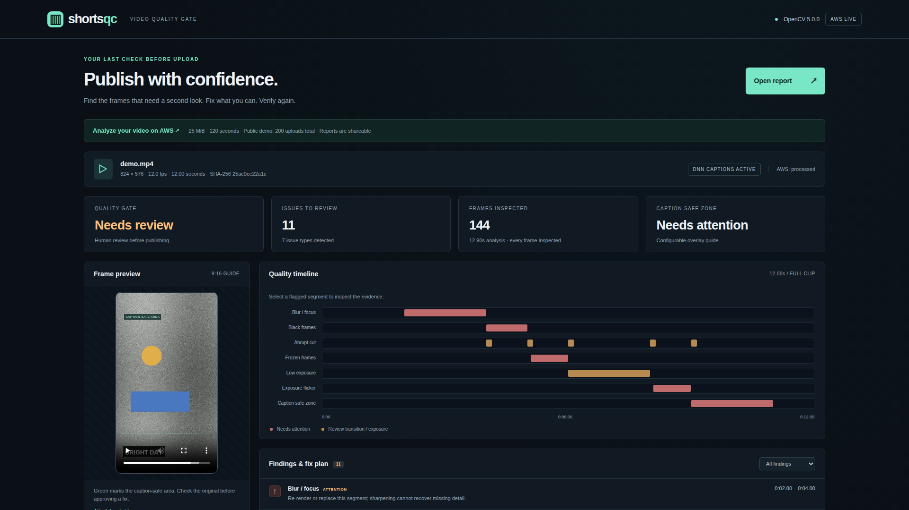
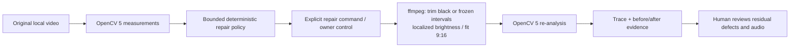
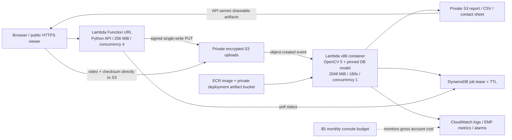

# Shorts QC

**An evidence-first quality gate that catches broken frames and unsafe captions before a vertical video goes live.**

Small sellers and studios produce shorts faster than they can review every frame. Shorts QC measures visual defects with **OpenCV 5**, produces an inspectable timeline and fix plan, and can apply bounded ffmpeg repairs before running the same checks again. It runs locally without API keys. The AWS delivery path packages the actual analyzer in a Lambda container; it is not a placeholder API.



Demo: **[Live HTTPS viewer and upload](https://sqwx2xhlolb632f7sbevcdes6y0xsdyq.lambda-url.ap-southeast-2.on.aws/)** · [original synthetic clip](media/demo.mp4) · [AWS execution evidence](media/aws-evidence.json). The hosted app runs real OpenCV 5 and DB caption inference on AWS. The final narrated video is handled separately.

## Run and test

Python 3.11+ (verified on Linux Python 3.12), ffmpeg/ffprobe, and libGL/glib are required. On Ubuntu: `sudo apt-get install ffmpeg libgl1 libglib2.0-0`. Heavy tasks in this project run on `pilot`, not the low-memory Mac.

```bash
python3.12 -m venv .venv
. .venv/bin/activate
pip install -r requirements.lock
pip install --no-deps --no-build-isolation -e .
python -m shorts_qc.model --output models/text.onnx
export SHORTS_QC_TEXT_MODEL="$PWD/models/text.onnx"
shorts-qc analyze input.mp4 --out work/report
shorts-qc serve work/report --host 127.0.0.1 --port 8080
# Open http://127.0.0.1:8080. Attach the original video in the viewer.
```

To inspect the committed demo: `shorts-qc serve media --port 8080`. To reproduce its data and evaluation:

```bash
shorts-qc synthesize --out work/synthetic --seed 2026
shorts-qc evaluate work/synthetic/manifest.json --out work/evaluation
SHORTS_QC_TEXT_MODEL=models/text.onnx python -m pytest -q
```

The model is optional for non-caption checks. Without it, the report explicitly says caption checks were not run and cannot return a clear gate. There is no LLM feature, fake LLM response, or required LLM API key; the repair controller is deterministic. `.env.example` documents optional environment variables; export them in the shell (no implicit dotenv loading).

## OpenCV 5 implementation

The runtime rejects non-5.x OpenCV. The exact wheel is `opencv-python==5.0.0.93` (runtime reports `cv2.__version__ == 5.0.0`). Dependencies are pinned in [requirements.lock](requirements.lock). Frames are decoded in sequence, reduced to a maximum dimension of 640, and inspected individually. Original dimensions are retained for aspect checks. Per-frame metrics remain in CSV even when brief isolated runs are suppressed in the timeline.

| Check | Substantive OpenCV analysis | Review decision |
| --- | --- | --- |
| Blur | `Laplacian` variance **and** high-frequency energy from `cv.dft`; both thresholds must fail | Replace/re-render; no promise of restoring lost detail |
| Black / exposure | Grayscale mean, fraction below 18, normalized `calcHist` histogram | Review black trims or localized exposure lift |
| Frozen | Consecutive `absdiff` plus local Gaussian-window SSIM implementation; sustained for 0.6s | Inspect whether a still was intended |
| Abrupt cut | Frame difference, local SSIM drop and mean-centered structure change; histogram distance exported | Review transition, never auto-trim a cut |
| Flash / flicker | Opposing large luminance derivatives within 0.25s with similar mean-centered structure | Inspect exposure oscillation; cannot certify photosensitive safety |
| Captions | Actual `dnn_TextDetectionModel_DB` inference with OpenCV Zoo PP-OCRv3 English DB model | Compare detected box extents with top/bottom/right/left safe-zone masks; edge contact flags clipping risk |
| Letterbox | Contiguous near-black rows/columns from all four edges | Review framing; exclude globally dark/black clips |
| Aspect ratio | Original width/height against 9:16 with tolerance | Fit and pad without stretching or cropping |

DB text inference runs every 0.5s by default; its most recent boxes persist until the next inference. Fast transient captions may be missed. Safe bounds are generic guides (left 5%, right 82%, top 10%, bottom 78%), **not guarantees about any platform's changing UI**. OpenCV cannot detect glyphs that no longer exist outside the frame; clipping means visible text touches an edge. No OCR text is sent to external services.

Configure thresholds with `--config settings.json`, a JSON object using the fields in [config.py](shorts_qc/config.py), for example `{"blur_laplacian":65,"blur_fft":0.012,"safe_bottom":0.78,"text_interval":0.25}`. Invalid, non-finite, unordered bounds are rejected. Local limits default to 180 seconds, 9,000 frames, and 16.7 MP source resolution. The cloud accepts at most 120 seconds, 7,200 frames, 60fps, 4.2MP and 100MiB. Variable frame rate uses nominal frame times; normalize to CFR before precise edits.

Each analysis produces `report.json` (schema 1.0, source hash, thresholds, issues and fix plan), `metrics.csv` (one row per decoded frame, text boxes included), and `contact-sheet.jpg` (eight annotated samples). Contact sheets are uniformly sampled summaries and may miss short defects; the timeline and CSV are authoritative. Local HTTP uses the small RangeHTTPServer library to support accurate video seeking and binds to loopback by default. The viewer accepts a report file or same-origin `?report=...`, filters findings, seeks the video and exports evidence. Report strings are inserted as text, not HTML.

## Perception → decision → action → verification



```bash
shorts-qc repair input.mp4 --out work/fixed --text-model models/text.onnx
```

The original 12-second demo produces 11 issues; the real repair trace reduces this to 6 residual issues, removing black/frozen findings while retaining blur, captions, dark exposure, flicker and cuts for review. Exposure is intentionally modest and does not force a passing result.

`analyze` never changes footage. `repair` is an explicit opt-in: it merges measured black/frozen intervals, retains the rest with synchronized audio trimming, adds 0.08 brightness only in detected dark intervals, and fits a 9:16 canvas. It refuses all-removed videos, more than 40 retained segments, VFR edits and overwriting an existing candidate. The original stays intact. It writes `repaired.mp4`, `before/`, `after/`, and `trace.json`. Residual blur, caption, flash and intentional-cut judgments stay visible; there is no automatic publishing. This is a real evidence-dependent tool loop, not an LLM explanation of a fixed report. Agentic award eligibility remains for the organizers to judge. COOL is not used or claimed.

## Evaluation and principal results

All footage is generated by our own [synthetic.py](shorts_qc/synthetic.py), with seeded texture, motion and rendered captions. No downloaded clips, stock media, logos, or third-party demo content. `manifest.json` records per-frame ground truth for 22 two-second clips: 11 calibration and 11 independently seeded heldout clips. Evaluation reports heldout data only (264 frames) and counts **every non-target frame as a negative**, without boundary tolerance. The same procedural generator underlies both splits; this is a small regression benchmark, not a claim of real-world accuracy. Thresholds are fixed before running heldout evaluation.

<!-- EVALUATION_RESULTS -->
| Defect | Precision | Recall | TP / FP / FN |
| --- | ---: | ---: | --- |
| blur | 1.000 | 1.000 | 24 / 0 / 0 |
| black | 1.000 | 1.000 | 24 / 0 / 0 |
| dark | 1.000 | 1.000 | 24 / 0 / 0 |
| frozen | 1.000 | 0.913 | 21 / 0 / 2 |
| flicker | 1.000 | 1.000 | 23 / 0 / 0 |
| scene_cut | 1.000 | 1.000 | 1 / 0 / 0 |
| caption_safe_zone | 1.000 | 1.000 | 48 / 0 / 0 |
| caption_clipped | 1.000 | 1.000 | 24 / 0 / 0 |
| letterbox | 1.000 | 1.000 | 24 / 0 / 0 |
| aspect_ratio | 1.000 | 1.000 | 24 / 0 / 0 |

Measured on pilot with the real DB network active, OpenCV 5.0.0, seed 2026. Frozen frames had two false negatives due to small encoder-induced differences at the start of the hold. Full confusion counts, per-clip seeds and limitations: [media/evaluation.json](media/evaluation.json). The mixed 12-second demo flags seven defect types; it is separate from the evaluation clips.

<!-- /EVALUATION_RESULTS -->

Failure cases: intentional static product shots resemble freezes; soft backgrounds resemble blur; rapid caption changes between DNN samples can be missed; stylized/small/non-English text is outside this model's reliable scope; exposure effects can resemble flicker; fades may trigger black/dark findings. The demo uses persistent English captions. A production benchmark needs consented, varied, manually annotated footage. No user study, revenue improvement, physical-device validation, real-platform safe-zone certification is made. AWS timings below are measured demo executions; costs are estimates, not billing guarantees.

## AWS deployment

Public HTTPS viewer: **https://sqwx2xhlolb632f7sbevcdes6y0xsdyq.lambda-url.ap-southeast-2.on.aws/**

Upload API: `POST https://sqwx2xhlolb632f7sbevcdes6y0xsdyq.lambda-url.ap-southeast-2.on.aws/api/uploads`. No login, key, or paid plan is required to try the original demo or upload owned footage. The default sample is a report produced by the deployed AWS worker, with the immutable original synthetic video for playback.



API flow: hash the clip with SHA-256; post `{ "filename": "clip.mp4", "size": 12345, "sha256": "<64 lowercase hex characters>" }` to `/api/uploads`; PUT the original bytes to the returned `upload_url` using every returned header; poll `status_url` until `COMPLETE`; open `/?report=<report_url>`. The browser does this automatically. Signed URLs last 180 seconds, bind the exact byte count and SHA-256, and require `If-None-Match: *`. A second write receives HTTP 412. Never save signed URLs in logs or source control.

The endpoint serves the dependency-free viewer from a small zip Lambda. The analyzer is an actual Linux container built on pilot and pushed to ECR; its pinned model is downloaded and verified at build time. There is no Vercel, CloudFront, NAT gateway, EC2 instance or always-running server. Public Function URL permissions include both invocation permissions required by current Lambda behavior. [Lambda URL permissions](https://docs.aws.amazon.com/lambda/latest/dg/urls-auth.html), [S3 signed checksums](https://docs.aws.amazon.com/AmazonS3/latest/userguide/using-presigned-url.html).

**Credit controls and limits:** the CLI confirmed an ACTIVE **FREE** plan with $100 credits on October 16, 2026, expiring April 16, 2027. ECR, Lambda, S3, DynamoDB, CloudWatch, CloudFormation and Budgets operations all succeeded on this account; no paid-plan upgrade occurred. The deploy script refuses a non-Free plan or <=$10 remaining credits. AWS documents that the Free plan ends when its credits or six months expire; services then stop unless the owner upgrades. [Free plan documentation](https://docs.aws.amazon.com/awsaccountbilling/latest/aboutv2/free-tier-plans.html).

The public demo admits **200 uploads total**, using an atomic DynamoDB counter without TTL, and closes new uploads at **2026-11-11 00:00 UTC**. Maximum input: **25 MiB, 120 seconds, 7200 frames, 60 fps, 4.2 megapixels**. The lightweight API reserves four concurrent executions and the analyzer reserves one; the Function URL consequently allows at most 40 requests/second and can return 429 during bursts. Invalid inputs persist a failed job without automatic retries; transient analysis errors have at most two asynchronous retries within one hour. Job leases deduplicate events and expose stopped-worker/retry states. No external LLM or API key is involved.

Estimated light judging traffic: **US$1–3/month before credits**, assuming <=200 small analyses, modest viewer traffic, one image, and no other account workloads. Lambda free allowances may reduce this further. Even if all 200 jobs hit their 180-second timeout three times, analyzer compute is about **$3.60 gross** at 2 GiB, before allowances; API requests, transfer, ECR, S3, DynamoDB and observability are additional. The $5 monthly AWS Budget tracks gross account costs excluding credits; Lambda errors and unusually high API traffic have CloudWatch alarms. These are **console monitors, without email/SNS subscribers or automatic shutoff**. A budget is not a spending cap, billing/credit balances lag, and public traffic or other workloads can consume shared credits. Keep the account on the Free plan; never upgrade it for this demo. [Lambda pricing](https://aws.amazon.com/lambda/pricing/), [Budget update delays](https://docs.aws.amazon.com/cost-management/latest/userguide/budgets-managing-costs.html).

Uploaded originals expire after seven days; reports/job records after 30 days; logs after 14 days. The immutable `demo/demo.mp4` and default report remain until explicit teardown. The original uploaded video stays private and is previewed locally through a browser blob URL; someone reopening a shared report can attach their own copy. Reports, metrics and contact sheets are shareable to anyone with their unguessable URL, so use owned demonstration footage. Expiration is asynchronous. Buckets and the table are retained on stack deletion.

**Created resources, Sydney (`ap-southeast-2`):** CloudFormation stack `shorts-qc`; Lambda `shorts-qc-api` and `shorts-qc-analyze` plus the public Function URL; ECR repository `shorts-qc`; S3 `shorts-qc-381183038133-ap-southeast-2-uploads`, `shorts-qc-reportbucket-b8qjap07vgrm`, `shorts-qc-381183038133-ap-southeast-2-artifacts`; DynamoDB `shorts-qc-Jobs-11REP610MY09F`; two IAM execution roles, two 14-day log groups, two CloudWatch alarms and Budget `shorts-qc-monthly-5-usd`. Exact IDs and configuration are in [AWS evidence](media/aws-evidence.json).

Deploy again from the Mac using the existing AWS CLI login (default profile), SSH access to pilot, and the established Python/test/model environment on pilot:

```bash
# cfn-lint must be installed on pilot; CFN_LINT can point to an existing executable.
CFN_LINT=/tmp/shortsqc-cfn312/bin/cfn-lint AWS_REGION=ap-southeast-2 ./infra/deploy.sh
# Set IMAGE_URI to an existing ECR URI to update only API/assets/infrastructure.
python3 scripts/aws-demo.py media/demo.mp4 /path/to/owned-repaired.mp4
# Refresh CLI logs/config/metrics later without re-running clips:
python3 scripts/aws-demo.py
```

[infra/deploy.sh](infra/deploy.sh) validates tests/template on pilot, builds and pushes the single-architecture container there, uploads the tiny API zip, and uses CloudFormation's SAM transform. Only a short-lived ECR login token crosses SSH stdin; Docker's temporary auth file lives in RAM and is removed. Mac AWS credentials are never copied to pilot or written in the repo. API secrets are not required. Build dependencies: Docker, Python environment from the run instructions, and `cfn-lint==1.57.2` on pilot; AWS CLI, SSH and rsync on the Mac. For a fresh pilot environment, install these dependencies there, download the pinned model, and set `CFN_LINT` to that environment's executable.

Run `VIEWER_URL=http://127.0.0.1:18765 npm run capture` against a bounded local viewer for offline browser checks. For the deployed app, sync the repository to pilot, run `node scripts/capture-aws.mjs` there, and copy back `media/aws-*.png`. Use `METRICS_ONLY=1` with that script to render the latest recorded CloudWatch metrics without uploading again. Set `CHROMIUM_PATH` to an existing pilot Chromium executable if its version differs from the pinned Playwright download. It checks actual browser upload/CORS/checksum, polling, DNN report, share URL, video decoding/206 ranges, evidence downloads, filters and mobile layout. All AWS screenshots use a **1920×1080** viewport. The AWS evidence screenshot is clearly labeled CLI output rendered for readability; it is not a screenshot of the AWS Console.

**Execution evidence:** [raw CLI/job evidence](media/aws-evidence.json), [AWS viewer](media/aws-viewer.png), [completed browser upload](media/aws-upload-complete.png), [CloudWatch request/timing evidence](media/aws-evidence.png), [CloudWatch metrics](media/aws-metrics.png).

| Real AWS run | Frames | OpenCV analysis | Upload to report | Result |
| --- | ---: | ---: | ---: | --- |
| Original synthetic demo | 144 | 12.899 s | 47.094 s | 11 findings; DNN captions active |
| Repaired synthetic demo | 120 | 6.713 s | 12.449 s | 6 findings; DNN captions active |
| Browser upload of original | 144 | 7.969 s | Browser flow passed | 11 findings; DNN captions active |

These are separate measurements: the report's analysis timer covers the detector; upload-to-report includes transfer, S3 event delivery, startup and polling. CloudWatch records worker durations and request IDs separately. The first worker's log shows 37.114 s execution plus 0.436 s initialization; measured maximum memory was 296 MiB. The repaired worker used 304 MiB. Latest CLI snapshot reports FREE/ACTIVE and **$140 remaining credits**; balance updates can lag.

**Verified on pilot:** 50 pytest cases pass, including real DNN/ffmpeg and signed-upload, single-write, cap, expiry, stopped-worker, and regional-endpoint checks. SAM lint (`cfn-lint 1.57.2`) passes. Offline browser checks and the live AWS Playwright flow both pass; the latter uploads through the actual browser and verifies S3 CORS, checksum headers, polling, shared reports, video ranges/seek, evidence downloads, filtering and mobile overflow. Three actual worker invocations completed with zero Lambda Errors in the captured CloudWatch buckets. No browser or dev server is left running by these checks.

### Cleanup after judging — keep live through approximately November 10

No cleanup was executed. After judging, the owner can first pause new traffic without losing reports:

```bash
export AWS_REGION=ap-southeast-2
aws lambda put-function-concurrency --function-name shorts-qc-api --reserved-concurrent-executions 0
aws lambda put-function-concurrency --function-name shorts-qc-analyze --reserved-concurrent-executions 0
```

After confirming the reports are no longer needed, remove the stack and retained data with these destructive commands. The commands use the exact current resource names; inspect them before running. There is no CloudFront distribution to disable.

```bash
aws cloudformation delete-stack --stack-name shorts-qc
aws cloudformation wait stack-delete-complete --stack-name shorts-qc
aws s3 rb s3://shorts-qc-381183038133-ap-southeast-2-uploads --force
aws s3 rb s3://shorts-qc-reportbucket-b8qjap07vgrm --force
aws s3 rb s3://shorts-qc-381183038133-ap-southeast-2-artifacts --force
aws dynamodb delete-table --table-name shorts-qc-Jobs-11REP610MY09F
aws ecr delete-repository --repository-name shorts-qc --force
```

CloudFormation removes the functions, Function URL, roles, log groups, alarms and Budget. The three buckets, retained table and separately created ECR repository require the explicit removals above. Verify `aws cloudformation describe-stacks --stack-name shorts-qc` reports no stack and the named S3/ECR/DynamoDB resources are gone. This task leaves everything live for judging.

## Competition delivery checklist / technical report

This README is the technical report: problem/users, architecture, OpenCV implementation, deployment method, evaluation, limitations and responsible operation are above. The official [overview](https://opencv26.devpost.com/), [rules](https://opencv26.devpost.com/rules) and [resources](https://opencv26.devpost.com/resources) were read with curl on 2026-10-16. They require substantive OpenCV 5 and a meaningful AWS component, judge-accessible code/archive, pinned dependencies and reproducible build/deploy/tests, architecture diagram, evaluation including failure cases, a working web endpoint **or arranged live screen-share**, and a public/unlisted **video of no more than five minutes showing the team, working app, architecture and principal results**. Agentic path additionally needs workflow/trace, task effectiveness, failure handling, observability and human control. [media/trace.json](media/trace.json) holds the local real repair loop.

Deadline discrepancy: page header says **2026-10-26 23:45 PDT**, while overview body says **23:59 PDT**. Use the earlier 23:45 PDT cutoff (2026-10-27 15:45 KST) unless organizers clarify. The owner must handle their own registration, team representation, final judge-accessible video hosting, and Devpost submission. The public endpoint is already deployed. This job does not register accounts or submit entries.

## What was built during the hackathon

Built from an empty repository for this competition: original OpenCV 5 detector pipeline, DB caption integration and safe-zone checks, JSON/CSV/contact-sheet evidence, static timeline viewer, synthetic dataset and measured evaluation, bounded ffmpeg repair/re-verification loop with traces, AWS SAM container deployment, public checksummed upload/status API, live HTTPS report viewer, credit controls, actual AWS end-to-end evidence, mocked cloud boundary tests and CI. OpenCV, NumPy, ffmpeg, AWS services and the pretrained external DB weights predate the project and are credited, not claimed as our inventions.

## External dependencies and license

Our code and generated media: **MIT**, Copyright (c) 2026 Kyoungsoo Kim; see [LICENSE](LICENSE). External libraries retain their own licenses. The optional [OpenCV Zoo PP-OCRv3 DB English model](https://github.com/opencv/opencv_zoo/tree/47534e27c9851bb1128ccc0102f1145e27f23f98/models/text_detection_ppocr) is Apache 2.0, Copyright (c) 2016 PaddlePaddle Authors; its license downloads beside the model. Model weights and third-party source code are not committed. Source commit and SHA-256 are pinned in [model.py](shorts_qc/model.py). Detector design follows [OpenCV's text spotting documentation](https://docs.opencv.org/5.x/d4/d43/tutorial_dnn_text_spotting.html). RangeHTTPServer (Apache 2.0) provides HTTP range delivery for the local viewer; Playwright is used only for browser verification/capture. ffmpeg is an external executable, not bundled code. No sponsor logos or trademarks are used as demo artwork.
