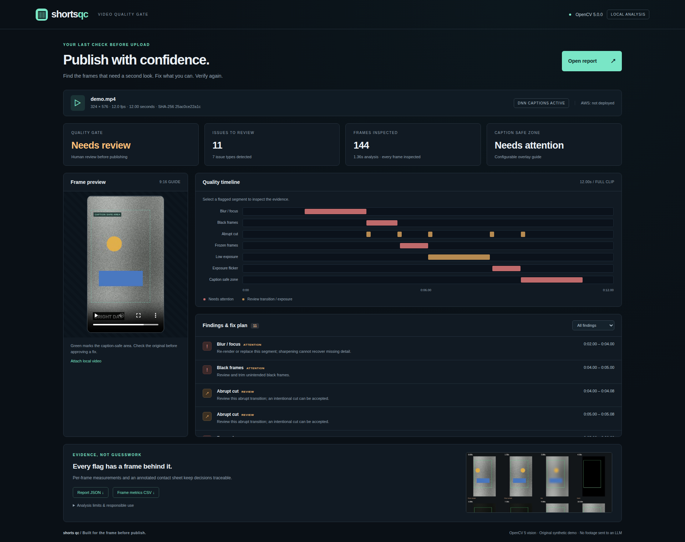
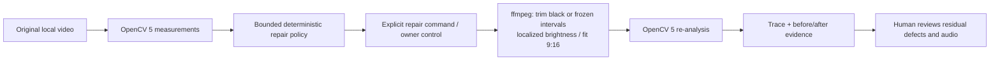
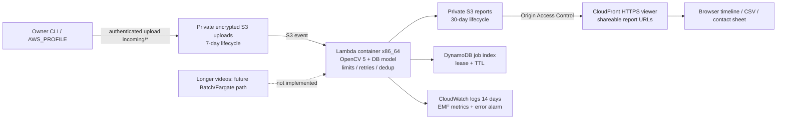

# Shorts QC

**An evidence-first quality gate that catches broken frames and unsafe captions before a vertical video goes live.**

Small sellers and studios produce shorts faster than they can review every frame. Shorts QC measures visual defects with **OpenCV 5**, produces an inspectable timeline and fix plan, and can apply bounded ffmpeg repairs before running the same checks again. It runs locally without API keys. The AWS delivery path packages the actual analyzer in a Lambda container; it is not a placeholder API.



Demo: [interactive viewer files](shorts_qc/web/index.html), [original synthetic demo](media/demo.mp4), [measured report](media/report.json), [screen capture](media/viewer-desktop.png). Launch locally with the commands below. A hosted demo and final narrated video are **not published**. AWS execution is **not yet verified** because the owner has no AWS account/credentials. Local results must not be represented as AWS evidence.

## Run and test

Python 3.11+ (verified on Linux Python 3.12), ffmpeg/ffprobe, and libGL/glib are required. On Ubuntu: `sudo apt-get install ffmpeg libgl1 libglib2.0-0`. Heavy tasks in this project run on `pilot`, not the low-memory Mac.

```bash
python3.12 -m venv .venv
. .venv/bin/activate
pip install -r requirements.lock
pip install --no-deps --no-build-isolation -e .
python -m shorts_qc.model --output models/text.onnx
export SHORTS_QC_TEXT_MODEL="$PWD/models/text.onnx"
shorts-qc analyze input.mp4 --out work/report
shorts-qc serve work/report --host 127.0.0.1 --port 8080
# Open http://127.0.0.1:8080. Attach the original video in the viewer.
```

To inspect the committed demo: `shorts-qc serve media --port 8080`. To reproduce its data and evaluation:

```bash
shorts-qc synthesize --out work/synthetic --seed 2026
shorts-qc evaluate work/synthetic/manifest.json --out work/evaluation
SHORTS_QC_TEXT_MODEL=models/text.onnx python -m pytest -q
```

The model is optional for non-caption checks. Without it, the report explicitly says caption checks were not run and cannot return a clear gate. There is no LLM feature, fake LLM response, or required LLM API key; the repair controller is deterministic. `.env.example` documents optional environment variables; export them in the shell (no implicit dotenv loading).

## OpenCV 5 implementation

The runtime rejects non-5.x OpenCV. The exact wheel is `opencv-python==5.0.0.93` (runtime reports `cv2.__version__ == 5.0.0`). Dependencies are pinned in [requirements.lock](requirements.lock). Frames are decoded in sequence, reduced to a maximum dimension of 640, and inspected individually. Original dimensions are retained for aspect checks. Per-frame metrics remain in CSV even when brief isolated runs are suppressed in the timeline.

| Check | Substantive OpenCV analysis | Review decision |
| --- | --- | --- |
| Blur | `Laplacian` variance **and** high-frequency energy from `cv.dft`; both thresholds must fail | Replace/re-render; no promise of restoring lost detail |
| Black / exposure | Grayscale mean, fraction below 18, normalized `calcHist` histogram | Review black trims or localized exposure lift |
| Frozen | Consecutive `absdiff` plus local Gaussian-window SSIM implementation; sustained for 0.6s | Inspect whether a still was intended |
| Abrupt cut | Frame difference, local SSIM drop and mean-centered structure change; histogram distance exported | Review transition, never auto-trim a cut |
| Flash / flicker | Opposing large luminance derivatives within 0.25s with similar mean-centered structure | Inspect exposure oscillation; cannot certify photosensitive safety |
| Captions | Actual `dnn_TextDetectionModel_DB` inference with OpenCV Zoo PP-OCRv3 English DB model | Compare detected box extents with top/bottom/right/left safe-zone masks; edge contact flags clipping risk |
| Letterbox | Contiguous near-black rows/columns from all four edges | Review framing; exclude globally dark/black clips |
| Aspect ratio | Original width/height against 9:16 with tolerance | Fit and pad without stretching or cropping |

DB text inference runs every 0.5s by default; its most recent boxes persist until the next inference. Fast transient captions may be missed. Safe bounds are generic guides (left 5%, right 82%, top 10%, bottom 78%), **not guarantees about any platform's changing UI**. OpenCV cannot detect glyphs that no longer exist outside the frame; clipping means visible text touches an edge. No OCR text is sent to external services.

Configure thresholds with `--config settings.json`, a JSON object using the fields in [config.py](shorts_qc/config.py), for example `{"blur_laplacian":65,"blur_fft":0.012,"safe_bottom":0.78,"text_interval":0.25}`. Invalid, non-finite, unordered bounds are rejected. Local limits default to 180 seconds, 9,000 frames, and 16.7 MP source resolution. The cloud accepts at most 120 seconds, 7,200 frames, 60fps, 4.2MP and 100MiB. Variable frame rate uses nominal frame times; normalize to CFR before precise edits.

Each analysis produces `report.json` (schema 1.0, source hash, thresholds, issues and fix plan), `metrics.csv` (one row per decoded frame, text boxes included), and `contact-sheet.jpg` (eight annotated samples). Contact sheets are uniformly sampled summaries and may miss short defects; the timeline and CSV are authoritative. Local HTTP uses the small RangeHTTPServer library to support accurate video seeking and binds to loopback by default. The viewer accepts a report file or same-origin `?report=...`, filters findings, seeks the video and exports evidence. Report strings are inserted as text, not HTML.

## Perception → decision → action → verification



```bash
shorts-qc repair input.mp4 --out work/fixed --text-model models/text.onnx
```

The original 12-second demo produces 11 issues; the real repair trace reduces this to 6 residual issues, removing black/frozen findings while retaining blur, captions, dark exposure, flicker and cuts for review. Exposure is intentionally modest and does not force a passing result.

`analyze` never changes footage. `repair` is an explicit opt-in: it merges measured black/frozen intervals, retains the rest with synchronized audio trimming, adds 0.08 brightness only in detected dark intervals, and fits a 9:16 canvas. It refuses all-removed videos, more than 40 retained segments, VFR edits and overwriting an existing candidate. The original stays intact. It writes `repaired.mp4`, `before/`, `after/`, and `trace.json`. Residual blur, caption, flash and intentional-cut judgments stay visible; there is no automatic publishing. This is a real evidence-dependent tool loop, not an LLM explanation of a fixed report. Agentic award eligibility remains for the organizers to judge. COOL is not used or claimed.

## Evaluation and principal results

All footage is generated by our own [synthetic.py](shorts_qc/synthetic.py), with seeded texture, motion and rendered captions. No downloaded clips, stock media, logos, or third-party demo content. `manifest.json` records per-frame ground truth for 22 two-second clips: 11 calibration and 11 independently seeded heldout clips. Evaluation reports heldout data only (264 frames) and counts **every non-target frame as a negative**, without boundary tolerance. The same procedural generator underlies both splits; this is a small regression benchmark, not a claim of real-world accuracy. Thresholds are fixed before running heldout evaluation.

<!-- EVALUATION_RESULTS -->
| Defect | Precision | Recall | TP / FP / FN |
| --- | ---: | ---: | --- |
| blur | 1.000 | 1.000 | 24 / 0 / 0 |
| black | 1.000 | 1.000 | 24 / 0 / 0 |
| dark | 1.000 | 1.000 | 24 / 0 / 0 |
| frozen | 1.000 | 0.913 | 21 / 0 / 2 |
| flicker | 1.000 | 1.000 | 23 / 0 / 0 |
| scene_cut | 1.000 | 1.000 | 1 / 0 / 0 |
| caption_safe_zone | 1.000 | 1.000 | 48 / 0 / 0 |
| caption_clipped | 1.000 | 1.000 | 24 / 0 / 0 |
| letterbox | 1.000 | 1.000 | 24 / 0 / 0 |
| aspect_ratio | 1.000 | 1.000 | 24 / 0 / 0 |

Measured on pilot with the real DB network active, OpenCV 5.0.0, seed 2026. Frozen frames had two false negatives due to small encoder-induced differences at the start of the hold. Full confusion counts, per-clip seeds and limitations: [media/evaluation.json](media/evaluation.json). The mixed 12-second demo flags seven defect types; it is separate from the evaluation clips.

<!-- /EVALUATION_RESULTS -->

Failure cases: intentional static product shots resemble freezes; soft backgrounds resemble blur; rapid caption changes between DNN samples can be missed; stylized/small/non-English text is outside this model's reliable scope; exposure effects can resemble flicker; fades may trigger black/dark findings. The demo uses persistent English captions. A production benchmark needs consented, varied, manually annotated footage. No user study, revenue improvement, physical-device validation, real-platform safe-zone certification or AWS latency/cost claim is made.

## AWS architecture and deployment



The design follows official [SAM image-function](https://docs.aws.amazon.com/serverless-application-model/latest/developerguide/sam-resource-function.html), [Lambda container](https://docs.aws.amazon.com/lambda/latest/dg/images-create.html), [CloudFront OAC](https://docs.aws.amazon.com/AmazonCloudFront/latest/DeveloperGuide/private-content-restricting-access-to-s3.html), and [Lambda concurrency](https://docs.aws.amazon.com/lambda/latest/dg/configuration-concurrency.html) documentation.

[infra/template.yaml](infra/template.yaml) is AWS SAM infrastructure; [infra/handler.py](infra/handler.py) runs the same real analyzer. The image downloads the pinned DB model at build time. IAM grants only the upload input prefix, report output prefix, job table and log group. Uploads are private, TLS-only and SSE-encrypted. Lambda concurrency is 2 and timeout is 540s; jobs use an ETag-derived ID and DynamoDB lease to tolerate duplicate events, and track failed retries. CloudWatch extracts completion/failure/analysis-time metrics from structured logs. Lifecycle expiration is asynchronous, not an exact-hour deletion guarantee. No credentials belong in files or Git.

The viewer and report images are intentionally **shareable to anyone with their CloudFront URL**; only publish owned synthetic/demo footage there. Original uploads are not served to the viewer: attach a local video when needed. Reports expire after 30 days, job records have 30-day TTL, and buckets/table are retained on stack deletion to avoid accidental loss. Cleanup of retained resources, ECR images, and CloudFront must be owner-managed; infrastructure is not claimed to be free. Longer videos are rejected, not silently sent to a nonexistent Batch service.

Build and smoke-test the container locally on Linux without AWS credentials:

```bash
docker build --provenance=false --platform linux/amd64 -f infra/Dockerfile -t shorts-qc:verify .
docker run --rm --network none --read-only --tmpfs /tmp:size=256m \
  --entrypoint python -v "$PWD/media:/input:ro" shorts-qc:verify \
  -m shorts_qc analyze /input/demo.mp4 --out /tmp/report --text-model /opt/models/text.onnx
```

Browser checks/captures (Node 22): `npm ci --ignore-scripts`, `npx playwright install chromium`, then run `shorts-qc serve media --port 18765` and `VIEWER_URL=http://127.0.0.1:18765 npm run capture`. `CHROMIUM_PATH` can select an already installed Chromium. Stop the server when finished. CI runs Python and browser checks on Ubuntu.

Once the owner has supplied an account and approved AWS use, on a machine with AWS CLI v2, SAM CLI and Docker:

```bash
AWS_PROFILE=owner AWS_REGION=us-east-1 ./infra/deploy.sh
```

This validates SAM, builds the real container, deploys the stack and syncs the viewer in one command. It prints the upload bucket, job table and viewer URL. Upload with the printed `aws s3 cp` command, inspect the job table's `report_key`, then open `https://<distribution>/viewer/index.html?report=../reports/<job_id>/report.json`. Lambda quotas must allow 3,072 MiB per function and two reserved workers; AWS requires at least 102 account concurrency units because 100 remain unreserved. New accounts may need a free quota increase; the deploy command checks concurrency before building. The account needs permission to create/update CloudFormation, IAM roles, ECR repositories, S3 buckets, Lambda functions, DynamoDB, CloudFront and CloudWatch resources. The runtime role is much narrower than the deployment role.

**Exactly what is needed from the owner for AWS:** (1) create/sign in to an AWS account and enable billing or applicable credits; (2) provide a configured AWS CLI profile via `AWS_PROFILE`, region, and a deployment role with the permissions above; (3) approve the deployment's possible AWS charges; (4) request any required free Lambda quota increase for 3,072 MiB memory and 102+ account concurrency. No LLM key, custom domain, new paid service or Devpost submission is needed to run the app. Credentials should be entered into the owner's credential manager/CLI, never sent in a report or committed.

**Validation status:** 38 pytest cases pass on pilot, including actual DNN inference and real ffmpeg audio preservation/trimming. Desktop (1920×1080 viewport) and mobile (390×844) Playwright checks pass for report loading, filters, precise timeline seeking, HTTP 206 ranges, evidence downloads, safe text insertion and overflow; captures are in `media/`. SAM template lint passes with cfn-lint 1.57.2. The actual Lambda image builds and real OpenCV+DNN handler analysis passes inside a network-disabled local container using mocked AWS services (2.419s for the 12-second demo; this is local timing). Cloud SAM template validation and handler tests are local infrastructure checks. No AWS account was created, no cloud resources were deployed, no money was spent, and no AWS workload execution is claimed. To complete competition evidence, run a real uploaded clip on AWS and retain its job ID, output JSON with OpenCV version, Lambda/CloudWatch execution logs, architecture/service configuration, and measured timing. The competition does not prescribe one specific AWS screenshot format; the substantive AWS workload must be demonstrable.

## Competition delivery checklist / technical report

This README is the technical report: problem/users, architecture, OpenCV implementation, deployment method, evaluation, limitations and responsible operation are above. The official [overview](https://opencv26.devpost.com/), [rules](https://opencv26.devpost.com/rules) and [resources](https://opencv26.devpost.com/resources) were read with curl on 2026-10-16. They require substantive OpenCV 5 and a meaningful AWS component, judge-accessible code/archive, pinned dependencies and reproducible build/deploy/tests, architecture diagram, evaluation including failure cases, a working web endpoint **or arranged live screen-share**, and a public/unlisted **video of no more than five minutes showing the team, working app, architecture and principal results**. Agentic path additionally needs workflow/trace, task effectiveness, failure handling, observability and human control. [media/trace.json](media/trace.json) holds the local real repair loop.

Deadline discrepancy: page header says **2026-10-26 23:45 PDT**, while overview body says **23:59 PDT**. Use the earlier 23:45 PDT cutoff (2026-10-27 15:45 KST) unless organizers clarify. The owner must handle their own registration, team representation, final judge-accessible video hosting, endpoint/live-demo arrangement, and Devpost submission. This job does not register accounts or submit entries.

## What was built during the hackathon

Built from an empty repository for this competition: original OpenCV 5 detector pipeline, DB caption integration and safe-zone checks, JSON/CSV/contact-sheet evidence, static timeline viewer, synthetic dataset and measured evaluation, bounded ffmpeg repair/re-verification loop with traces, AWS SAM container deployment, mocked cloud boundary tests and CI. OpenCV, NumPy, ffmpeg, AWS services and the pretrained external DB weights predate the project and are credited, not claimed as our inventions.

## External dependencies and license

Our code and generated media: **MIT**, Copyright (c) 2026 Kyoungsoo Kim; see [LICENSE](LICENSE). External libraries retain their own licenses. The optional [OpenCV Zoo PP-OCRv3 DB English model](https://github.com/opencv/opencv_zoo/tree/47534e27c9851bb1128ccc0102f1145e27f23f98/models/text_detection_ppocr) is Apache 2.0, Copyright (c) 2016 PaddlePaddle Authors; its license downloads beside the model. Model weights and third-party source code are not committed. Source commit and SHA-256 are pinned in [model.py](shorts_qc/model.py). Detector design follows [OpenCV's text spotting documentation](https://docs.opencv.org/5.x/d4/d43/tutorial_dnn_text_spotting.html). RangeHTTPServer (Apache 2.0) provides HTTP range delivery for the local viewer; Playwright is used only for browser verification/capture. ffmpeg is an external executable, not bundled code. No sponsor logos or trademarks are used as demo artwork.
