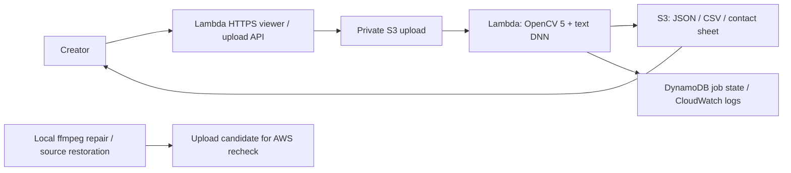

# Shorts QC

Find blurry shots, black gaps and captions near app controls before publishing a vertical video.

**[Try the live AWS app](https://sqwx2xhlolb632f7sbevcdes6y0xsdyq.lambda-url.ap-southeast-2.on.aws/)** · [Source](https://github.com/kks0488/shorts-qc)

Creators cannot easily inspect every frame. Shorts QC helps them:

- Upload an owned short and inspect findings with timestamps, a timeline and frame evidence.
- Download unmodified reports, per-frame measurements and an annotated contact sheet.
- Repair eligible issues locally, or restore flagged spans from a matching clean source export, then check again.



Sponsor technology:

- **OpenCV 5.0.0:** Laplacian and Fourier sharpness; luminance/histograms; frame difference and SSIM; exposure changes, borders and aspect ratio. The actual DB text network checks safe bounds and edge contact every 0.5s. Blur and low exposure suppress unreliable freeze recommendations.
- **AWS:** container analysis in Lambda, private S3, DynamoDB job leases, ECR and CloudWatch. The viewer polls real job results. No LLM or additional API key is needed.

## Quick start

Python 3.11+, ffmpeg/ffprobe, libGL and glib. Run processing, browsers and builds on pilot/Linux.

```sh
python3 -m venv .venv
. .venv/bin/activate
pip install -r requirements.lock
pip install --no-deps --no-build-isolation -e .
python -m shorts_qc.model --output models/text.onnx
export SHORTS_QC_TEXT_MODEL="$PWD/models/text.onnx"
shorts-qc analyze input.mp4 --out work/report
shorts-qc serve work/report --port 8080
python -m pytest -q
# Optional, explicit local repairs (originals remain intact):
shorts-qc repair input.mp4 --out work/fixed
shorts-qc repair damaged.mp4 --reference aligned-original.mp4 --out work/restored
```

Attach the original video in localhost:8080. Without the text model, reports say captions were not checked. Override thresholds using `--config settings.json`; see [config.py](shorts_qc/config.py). GitHub Actions runs Python, deployment-template and browser checks.

## Evaluation and boundaries

[Live evaluation](media/realism-results.json) records original screen-demo shorts, clean controls and source-restored candidates processed on AWS. Each damaged short has 1s blur, 0.5s black and bottom-cut text; the studio short also has a 1.5s freeze and 1s low exposure. All nine live runs (2,592 frames) passed: six evaluated checks had zero frame-level false positives/negatives; all three clean controls and all three restored candidates had zero findings. Analysis took 9.84–10.41s; upload-to-report took 16.10–20.18s including polling. Exact intervals and raw report links are retained. Full JSON/CSV and per-clip Markdown are outside the repo in `hackathons/opencv/samples/raw/`.

Reproduce on pilot in a fresh `work/gate` directory (use `CHROMIUM_PATH` for an existing browser):

```sh
npm ci
node scripts/realism.mjs work/gate
python scripts/realism-live.py work/gate/manifest.json --repair \
  --text-model models/text.onnx --out work/gate/raw \
  --endpoint https://sqwx2xhlolb632f7sbevcdes6y0xsdyq.lambda-url.ap-southeast-2.on.aws
GATE_RESULTS=work/gate/raw/realism-results.json node scripts/capture-aws.mjs
```

Failure cases found during development: severe blur and dark motion produced false freeze suggestions; these are now withheld when motion evidence is unreliable. A moving control title crossed the top guide; its layout was corrected without weakening the detector. The separate [11-clip synthetic benchmark](media/evaluation.json) is a small regression check.

These controlled compositions are not a real-world accuracy claim. Intentional stills, cuts and fades need review. Generic safe zones are not platform guarantees. The English text model may miss brief, small or stylized text; edge contact cannot prove missing words. VFR times are approximate. Generic repair trims black/frozen spans and lifts exposure; it cannot recover lost detail. Source restoration requires the matching aligned clean export and copies input audio unchanged. Inspect video and audio before publishing. Use owned or consented footage; report links are shareable.

## Deploy and retain

[infra/deploy.sh](infra/deploy.sh) tests/builds on pilot and updates the existing AWS stack through the Mac's AWS login:

```sh
CFN_LINT=/tmp/shortsqc-cfn312/bin/cfn-lint ./infra/deploy.sh
```

The public demo accepts 25MiB, 120s, 60fps and 4.2MP, with one worker, 200 lifetime uploads and a November 11, 2026 UTC upload cutoff. Signed uploads bind checksums and reject overwrites. Originals expire after 7 days; reports/jobs after 30. The existing Free plan uses credits; the $5 budget is an alert, not a spending cap. [AWS evidence and resource names](media/aws-evidence.json).

Keep resources live through judging (about November 10). Afterwards, pause both functions by setting reserved concurrency to zero. Delete stack `shorts-qc` in `ap-southeast-2` only when reports are no longer needed; retained buckets/table and ECR need explicit removal. No teardown was run.

## What was built during the hackathon

Original OpenCV pipeline, text integration, timeline viewer, evidence exports, generated evaluation clips, repair/recheck and source-restoration loops, live AWS deployment, tests, CI and demo film. The 2:30 English-captioned film is delivered as `hackathons/opencv/opencv_demo_final.mp4`; public video upload and Devpost submission remain owner actions.

[MIT](LICENSE) · Copyright (c) 2026 Kyoungsoo Kim. Our code and original media are MIT; external libraries retain their licenses. The optional [OpenCV Zoo PP-OCRv3 DB model](https://github.com/opencv/opencv_zoo/tree/47534e27c9851bb1128ccc0102f1145e27f23f98/models/text_detection_ppocr) is Apache 2.0; weights/license download separately with pinned provenance in [model.py](shorts_qc/model.py).
