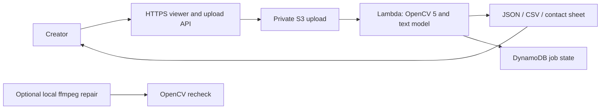

# Shorts QC

Find blurry shots, black gaps and text near app controls before publishing a vertical video.

**[Try the live AWS app](https://sqwx2xhlolb632f7sbevcdes6y0xsdyq.lambda-url.ap-southeast-2.on.aws/)** · [Source](https://github.com/kks0488/shorts-qc)

Creators cannot easily inspect every frame. Shorts QC helps them:

- Upload an owned short and review a timeline with specific times and plain-language fixes.
- Download the measured report, frame metrics and an annotated contact sheet.
- Optionally repair supported issues locally, then check the result again. Original footage stays intact.



Sponsor technology:

- **OpenCV 5.0.0:** Laplacian and Fourier sharpness, luminance/histograms, frame difference and SSIM, exposure changes, borders and aspect ratio. The actual DB text network checks configurable safe bounds and edge contact. Severe blur cannot also trigger a freeze trim.
- **AWS:** real container analysis in Lambda, private S3 storage, DynamoDB job leases, ECR, and CloudWatch logs/metrics. The public viewer polls actual job results. No LLM or API key is needed.

## Quick start

Python 3.11+, ffmpeg/ffprobe, libGL and glib. Run builds, browser checks and video processing on pilot/Linux.

```sh
python3 -m venv .venv
. .venv/bin/activate
pip install -r requirements.lock
pip install --no-deps --no-build-isolation -e .
python -m shorts_qc.model --output models/text.onnx
export SHORTS_QC_TEXT_MODEL="$PWD/models/text.onnx"
shorts-qc analyze input.mp4 --out work/report
shorts-qc serve work/report --port 8080
python -m pytest -q
# Optional: shorts-qc repair input.mp4 --out work/fixed --text-model models/text.onnx
```

Open localhost:8080 and attach the original video. Without the text model, reports explicitly say captions were not checked. Threshold overrides use `--config settings.json`; fields are in [config.py](shorts_qc/config.py). GitHub Actions runs tests and template/browser checks.

## What we measured

The [synthetic evaluation](media/evaluation.json) covers 11 independently seeded heldout clips (264 frames), separate from calibration, across ten checks. It is a small regression benchmark.

[realism.mjs](scripts/realism.mjs) makes two original 720×1280 creator shorts from our own app captures, with a clean control for each. Each damaged short has **1s blur, 0.5s black and 2s bottom-cut text**. [realism-live.py](scripts/realism-live.py) uploads all four to live AWS and scores every decoded frame, including off-target negatives, without boundary tolerance. Results and limitations: [media/realism-results.json](media/realism-results.json). Full JSON/CSV and readable reviews are saved outside the repo in `hackathons/opencv/samples/`.

Reproduce on pilot (set `CHROMIUM_PATH` if needed):

```sh
npm ci
node scripts/realism.mjs work/realism
python scripts/realism-live.py work/realism/manifest.json --endpoint https://sqwx2xhlolb632f7sbevcdes6y0xsdyq.lambda-url.ap-southeast-2.on.aws --out work/realism/results
```

These two screen-demo styles are not a real-world accuracy claim. An earlier control's moving title crossed the top guide; we corrected its layout rather than weakening the detector. Severe blur caused a false freeze recommendation; the analyzer now withholds that recommendation when motion cannot be measured reliably.

Intentional stills, fades and cuts need review. Safe zones are generic guides, not platform guarantees. The English DB model samples text every 0.5s and may miss brief, small or stylized text. Edge contact signals clipping risk; it cannot prove missing words. Variable-rate video uses approximate times. Sharpening cannot restore lost detail. Repairs need a final visual/audio review.

## AWS deployment and teardown

[infra/deploy.sh](infra/deploy.sh) tests/builds on pilot and deploys the SAM template through CloudFormation using the Mac's AWS login: `CFN_LINT=/tmp/shortsqc-cfn312/bin/cfn-lint ./infra/deploy.sh`. Set `IMAGE_URI` to reuse an image. Optional authenticated commerce state shares the existing table; financial records do not expire.

The public demo accepts 25MiB, 120s, 60fps and 4.2MP, with one worker, 200 lifetime uploads and a November 11, 2026 UTC upload cutoff. Signed uploads bind the checksum and reject overwrites. Originals expire after 7 days, reports/jobs after 30. Keep the existing AWS Free plan; the $5 console budget monitors costs and is not a spending cap.

After judging, pause `shorts-qc-api` and `shorts-qc-analyze` by setting reserved concurrency to zero. Delete stack `shorts-qc` in `ap-southeast-2` only when reports are no longer needed; retained buckets/table and separate ECR repository need explicit removal. Exact names: [AWS evidence](media/aws-evidence.json). No teardown was run.

## What was built during the hackathon

Original detector pipeline, text integration, timeline viewer, evidence exports, generated evaluation videos, repair/recheck loop, AWS upload/analysis deployment, tests and CI. [Repair trace](media/trace.json). Narrated video and Devpost submission remain owner tasks.

[MIT](LICENSE) · Copyright (c) 2026 Kyoungsoo Kim. Our code and original media are MIT; external libraries keep their licenses. The optional [OpenCV Zoo PP-OCRv3 DB model](https://github.com/opencv/opencv_zoo/tree/47534e27c9851bb1128ccc0102f1145e27f23f98/models/text_detection_ppocr) is Apache 2.0; weights/license download separately with pinned provenance in [model.py](shorts_qc/model.py).
